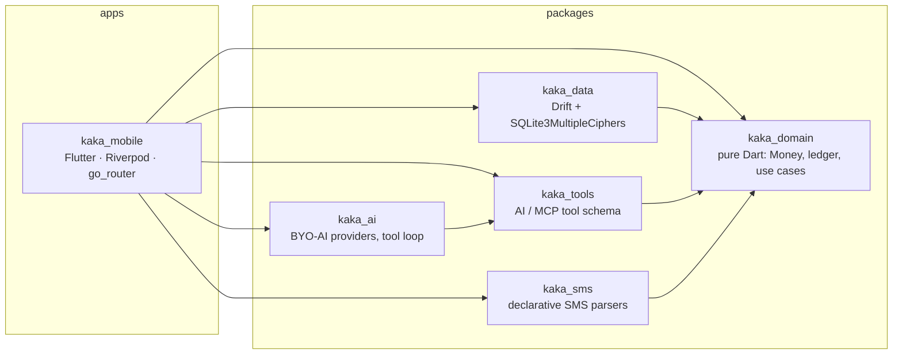

# Kaka · کاکا

> **حساب حسابه، کاکا برادر** — a free, open-source, offline personal-finance app.
> Persian & English, Jalali & Gregorian, rial/toman and other currencies, real double-entry bookkeeping.

**Status:** v0.5.1 pre-release — ledger, bank SMS (incl. opt-in background), budgets, repeating transactions, CSV import, rates & gold, encrypted backups, BYO-AI & MCP. Android first. See [`TASKS.md`](TASKS.md) for what's done and what's next.

[فارسی ↓](#فارسی)

## Why Kaka is different
- **Offline, no account, no server.** Your ledger lives encrypted on your phone (SQLite3MultipleCiphers, key in the Android Keystore). Nothing is sent anywhere.
- **Open source, free forever.** MIT licensed. No payments, no ads, no telemetry.
- **Bring your own AI** *(in progress)*: your own API key (Gemini, OpenRouter, DeepSeek… any OpenAI-compatible endpoint), a local server like Ollama, an on-device model — or no AI at all. The app is complete without it.
- **Ask your books from Claude or Cursor via MCP** *(planned)*: Kaka exposes one stable tool set ([`packages/kaka_tools/schema/tools.v1.json`](packages/kaka_tools/schema/tools.v1.json)) used by the in-app AI, a desktop `kaka-mcp` server, and later Android AppFunctions. AI can only *propose* entries; you approve them.
- **Money done right.** Amounts are integers in minor units, never floats. Every transaction's postings sum to zero per currency. Toman is a display unit of rial, so bank SMS (in rial) and your input (in toman) never get mixed up.
- **Pluggable everything.** Bank SMS parsers and on-device models are JSON catalogs — adding a bank or a model is a pull request, not a code change.

## Architecture

Clean Architecture: `kaka_domain` knows nothing about Flutter or storage; `kaka_data` implements its repository interfaces; the app wires them with Riverpod.

| Path | What |
|---|---|
| `apps/kaka_mobile` | Flutter app (features: onboarding, home, accounts, transactions, settings) |
| `packages/kaka_domain` | Entities, value objects, ledger rules, use cases |
| `packages/kaka_data` | Encrypted Drift database and repositories |
| `packages/kaka_tools` | Tool catalog shared by AI and MCP |
| `packages/kaka_sms` | SMS parser engine + `sms-parsers.v1.json` |
| `packages/kaka_ai` | AI provider abstraction, model catalog |
| `model_catalog/` | On-device model manifest |
| `docs/architecture-v4.md` | Full design (Persian) |

## Build
Requirements: Flutter stable (3.47+), Java 17, Android SDK.
```bash
flutter pub get                       # from the repo root (pub workspace)
cd apps/kaka_mobile
flutter run                           # on a device/emulator
flutter build apk --release --split-per-abi
```
Tests:
```bash
for p in packages/*; do (cd $p && dart test); done
(cd apps/kaka_mobile && flutter test)
```
After changing Drift tables: `cd packages/kaka_data && dart run build_runner build`.
After changing tools: `cd packages/kaka_tools && dart run bin/export_schema.dart`.

Encryption comes from `hooks: user_defines: sqlite3: source: sqlite3mc` in the root `pubspec.yaml`; the database refuses to open without it.

## Contributing
Bank SMS templates are the most wanted contribution — please **mask card numbers, balances and names** before sharing any sample. See [`CONTRIBUTING.md`](CONTRIBUTING.md).

---

## فارسی

**کاکا** یه اپ حساب‌وکتاب شخصی رایگان، متن‌باز و آفلاینه.

- **آفلاین، بدون ثبت‌نام، بدون سرور:** دفتر حسابت رمزشده روی گوشی خودته و کلیدش توی Keystore اندرویده. هیچ داده‌ای جایی فرستاده نمی‌شه.
- **رایگان و متن‌باز:** با لایسنس MIT. بدون پرداخت، بدون تبلیغ، بدون ردیابی.
- **هوش مصنوعی به انتخاب خودت** *(در حال ساخت)*: کلید API خودت (Gemini، OpenRouter، DeepSeek و هر سرویس سازگار با OpenAI)، سرور محلی مثل Ollama، مدل روی گوشی، یا اصلاً بدون هوش مصنوعی. اپ بدون اون هم کامل کار می‌کنه.
- **از حساب‌هات با Claude یا Cursor بپرس (MCP)** *(برنامه‌ریزی‌شده)*: یه مجموعه ابزار ثابت برای هوش مصنوعی داخل اپ، سرور MCP دسکتاپ و بعداً AppFunctions. هوش مصنوعی فقط پیشنهاد ثبت می‌ده و تأیید با خودته.
- **حساب دقیق:** مبالغ عدد صحیح‌ان، نه اعشاری. دفتر دوطرفه‌ست و هر تراکنش در هر ارز تراز می‌شه. تومان فقط واحد نمایش ریاله.
- **فارسی کامل:** تقویم شمسی و میلادی، ارقام فارسی یا لاتین، راست‌به‌چپ، ارزهای ریال، تومان، دلار، یورو و درهم.
- **قابل گسترش:** پارسر پیامک بانک‌ها و مدل‌های روی گوشی فایل JSON‌ان؛ اضافه کردن بانک یا مدل جدید فقط یه Pull Request‌ه.

**ساخت:** Flutter پایدار، Java 17 و Android SDK لازمه. از ریشه‌ی ریپو `flutter pub get` و بعد داخل `apps/kaka_mobile` دستور `flutter build apk --release` رو اجرا کن.

لیست کارها توی [`TASKS.md`](TASKS.md) و معماری کامل توی [`docs/architecture-v4.md`](docs/architecture-v4.md)‌ه.

## License
[MIT](LICENSE) © 2026 Vahid HJ
